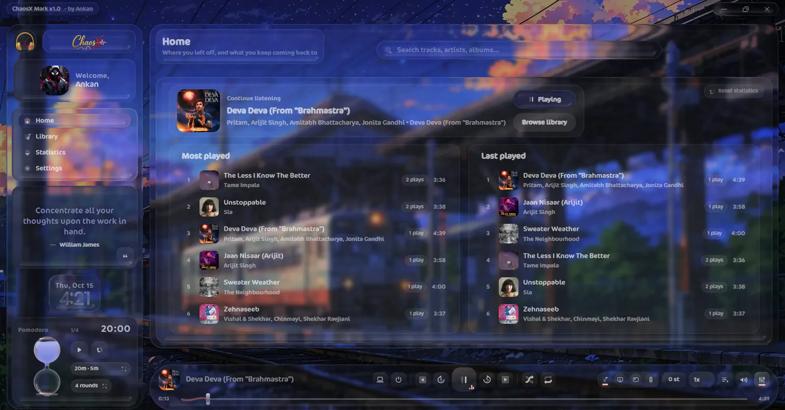
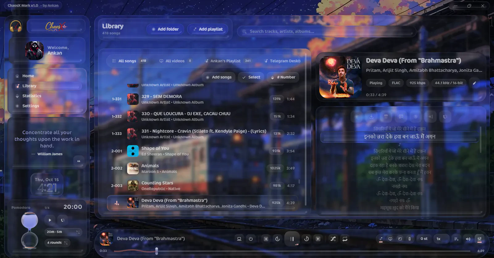
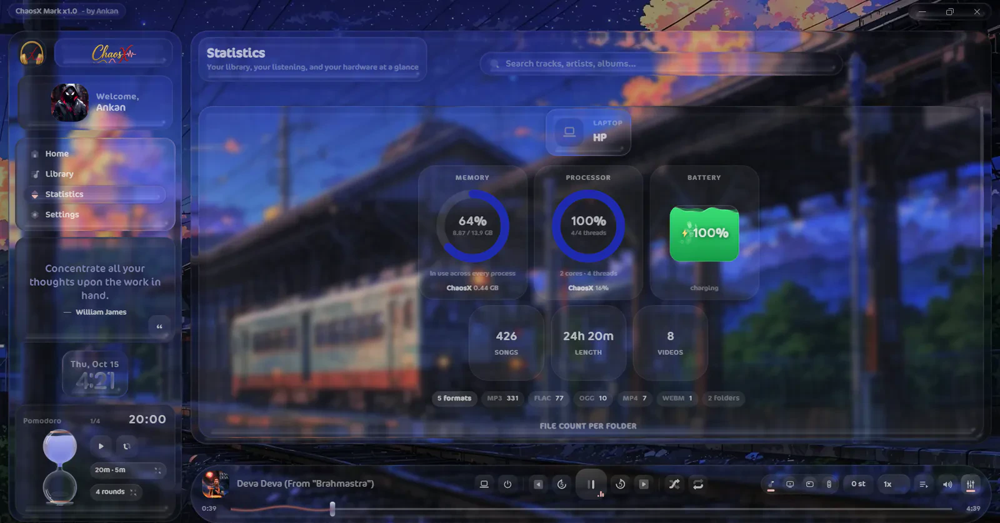
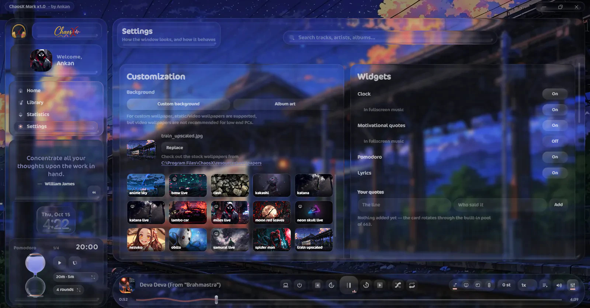
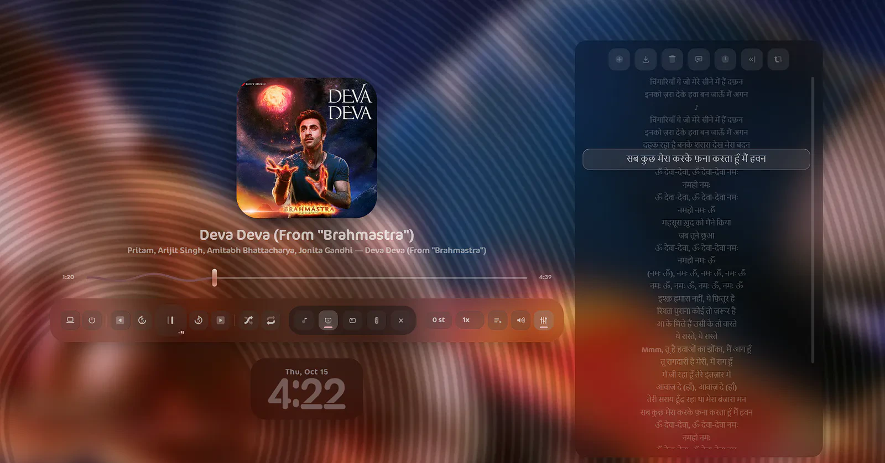
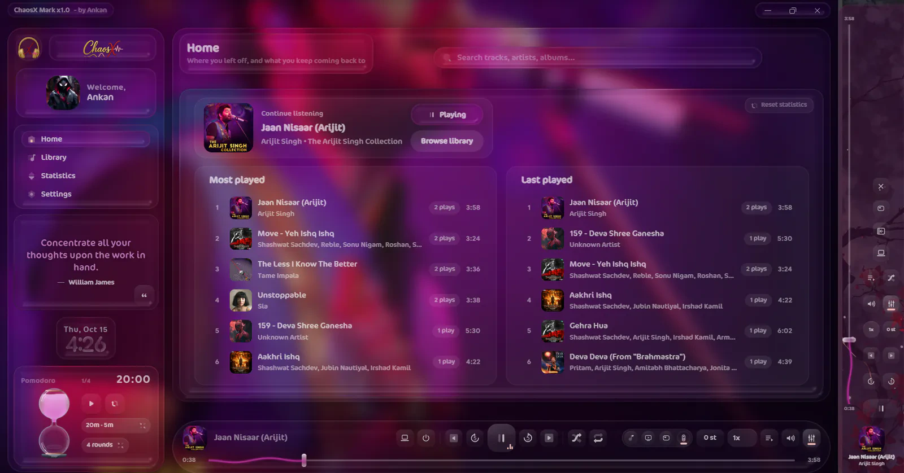
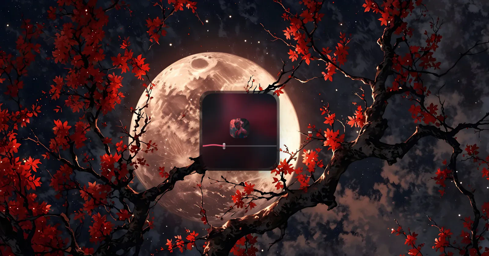
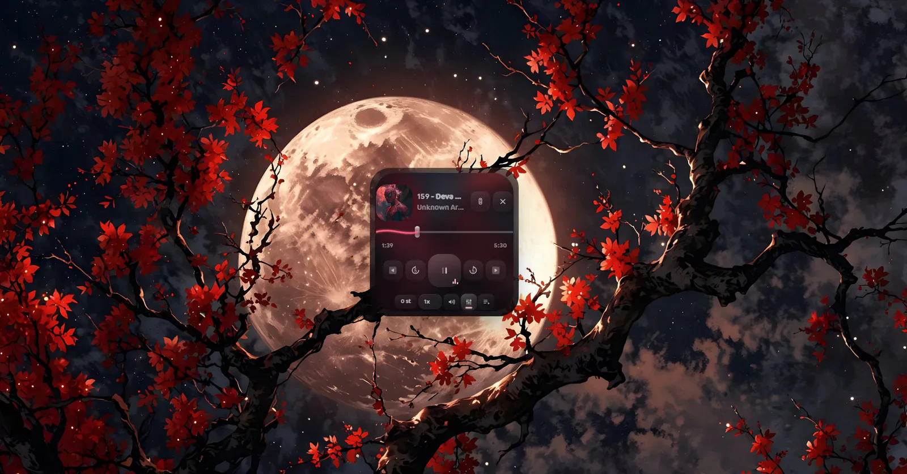
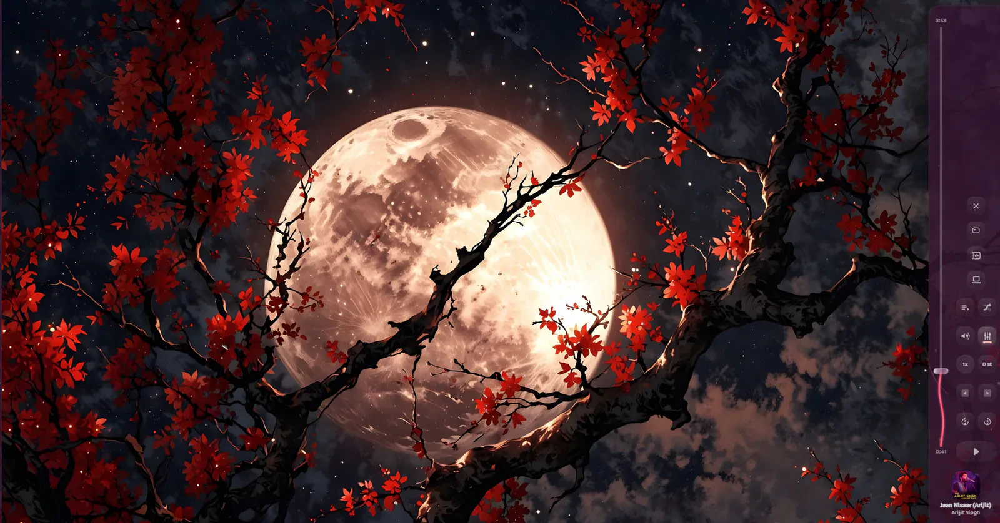

# 🎧 ChaosX — Music Player (Mark x1.0)

## 🌌 Introduction

ChaosX is an offline-first music player for Windows, built for people who want more than just a play button. It supports a wide range of audio formats, along with offline video playback, wrapped in a highly polished **Liquid Glass + Gaussian Blur** interface powered by a real shader engine — not just basic CSS glassmorphism.

Designed to run on modest hardware, ChaosX targets systems with at least a dual-core, 4-thread CPU and 4 GB of RAM. Every detail, from audio handling to subtle UI animations, is designed to make everyday listening feel special without demanding flagship hardware. It's more than a music player; it's a complete desktop experience for students and adults who value their local music libraries, including lossless audio, without the ads and compromises of online streaming.

## ✨ Features

- 🎵 **Wide Format Support:** Play a broad range of audio formats, plus offline video playback.
- 🎧 **Gapless Playback:** Enjoy continuous listening with gapless playback enabled by default.
- 🎚️ **Audio Controls:** Fine-tune playback speed and pitch, with built-in equalizers and essential playback controls.
- 🎤 **Lyrics Support:** Fetch lyrics through LRCLIB. Accuracy and availability depend on the provider and track metadata.
- 🪟 **Four Playback Modes:** Switch between the main player, fullscreen music/video mode, a compact miniplayer, and the pill mode.
- ⌨️ **Custom Controls:** Remap keybinds and control playback using supported hardware media keys.
- 🪄 **Real Liquid Glass UI:** A shader-powered visual experience combining liquid-glass effects, Gaussian blur, and carefully tuned animations.
- 🎨 **Dynamic Theme Engine:** Transform your player using album-art-based backdrops. Adjust blur, darkness, and colour depth to match your taste.
- 🖼️ **Custom Wallpapers:** Use static or live wallpapers, including a selection of developer-curated options. You can also add your own wallpapers, and tweak colours here too.
- 🕰️ **In-App Goodies:** Enjoy an iOS-inspired liquid-glass clock, quote cards, and a built-in Pomodoro timer.
- 📊 **Listening Statistics:** Track your most-played and recently played songs, total track counts, listening durations, and on-site hardware resource usage.

📸 **Screenshots:** Check out the screenshots below to explore the interface, playback modes, themes, and other features in action.

### Home & Library

<p align="center">
  <br>
  <em><b>Home</b> — continue listening, most played and last played, over a live wallpaper.</em>
</p>

<p align="center">
  <br>
  <em><b>Library</b> — 418 songs from pinned folders, with the now-playing card and synchronised lyrics docked alongside.</em>
</p>

### Statistics & Settings

<p align="center">
  <br>
  <em><b>Statistics</b> — listening totals next to live memory, CPU and battery, read from the same counters Task Manager shows.</em>
</p>

<p align="center">
  <br>
  <em><b>Settings</b> — background and wallpaper picker on the left, widget switches on the right. Every wallpaper is swappable with your own.</em>
</p>

### The other modes

<table>
  <tr>
    <td width="50%">
      <br>
      <em><b>Fullscreen music</b> — the record filling the monitor, with lyrics and the glass clock over it.</em>
    </td>
    <td width="50%">
      <br>
      <em><b>Dynamic theme</b> — the backdrop drawn from the playing record instead of a wallpaper, glass and all.</em>
    </td>
  </tr>
  <tr>
    <td>
      <br>
      <em><b>Mini, collapsed</b> — a floating card that stays above everything else you are doing.</em>
    </td>
    <td>
      <br>
      <em><b>Mini, expanded</b> — the full transport, still inside that card.</em>
    </td>
  </tr>
  <tr>
    <td colspan="2">
      <br>
      <em><b>Pill mode</b> — the transport as a capsule docked to a screen edge, expanding from the side it lives on.</em>
    </td>
  </tr>
</table>

## 🛠️ Bugs & Known Issues

ChaosX is still in its early stages, so expect occasional bugs, unexpected behaviour, and even sudden crashes. Subtle stutters may occur on weaker hardware, particularly when demanding visual effects are active.

Bug reports, suggestions, and constructive criticism are always welcome! ❤️ Just keep things respectful, there's a human behind the project, and the developer is a little sensitive. Please include steps to reproduce a bug whenever possible; it makes fixing things much easier.

## 🚧 What's Next?

Some ideas are already on the wishlist, while others are still being explored:

- 🌐 **Online Music Playback:** Partial support for online music playback, ideally without ads. This is still a wishlist item, and implementation may be challenging.
- 🧠 **Mood-Based Queue:** A lightweight system that builds a queue from your available songs based on your mood.
- 🐧 **Cross-Platform Support:** Potential ports to Linux, macOS, and Android.
- ⚡ **A More Efficient Engine:** Exploring a complete rewrite using a more efficient underlying engine.
- 🔄 **OTA Updates:** Over-the-air updates to make keeping the player up to date easier.

These are plans and possibilities, not promises. Feature requests are welcome, but implementation depends on feasibility, time, and available resources.

## 📦 Dependencies

*Dependencies and third-party libraries are listed in its own document.*

The full inventory — runtime libraries and their transitive packages, build tooling, the
vendored glass engine, the bundled mpv and FFmpeg binaries, icons and the
lyrics service, each with author and licence — lives in
**[THIRD-PARTY-NOTICES.md](THIRD-PARTY-NOTICES.md)**.

## 💖 Credits & Acknowledgements

ChaosX is an independent, vibe-coded project built with a lot of experimentation, late nights, and a genuine love for music and UI customization, and UX. Credit goes to the developers and maintainers of the libraries, frameworks, audio tools, and other technologies that make this project possible, as well as the testers whose time, feedback, and bug reports help improve the experience.

Runs on [Electron](https://www.electronjs.org/), [React](https://react.dev/),
[Vite](https://vite.dev/), [zustand](https://github.com/pmndrs/zustand),
[Tone.js](https://tonejs.github.io/), [music-metadata](https://github.com/Borewit/music-metadata),
[koffi](https://koffi.dev/) and [mpv](https://mpv.io/). Lyrics come from
[LRCLIB](https://lrclib.net/). The refracting glass is a modified port of
[liquidglass](https://github.com/ybouane/liquidglass) by [ybouane](https://x.com/ybouane).
Interface icons are from the [Plumpy set by Icons8](https://icons8.com/icons/set/plumpy).

If you enjoy ChaosX, consider ⭐ starring the repository, sharing your feedback, reporting bugs, or suggesting features. Every bit of support helps the project grow.

**Built with passion. Designed for the experience. 🎶**
**By Ankan.**

---

## ✅ Requirements

Windows 10 or 11, x64. The liquid glass needs WebGL 2, which every machine this targets
has; the acrylic backdrop needs Windows 11 and is skipped quietly where it is not there.

## 📥 Install

Grab the latest from [Releases](https://github.com/ankan2008/ChaosX/releases):

- **`ChaosX Mark x1.0-Setup.exe`** — the installer. It asks where to put it, and adds a
  Start Menu and desktop shortcut.
- **`ChaosX Mark x1.0-portable.exe`** — one file, no install. Run it from wherever you
  like; it keeps its settings and its library cache in your user profile, not next to
  itself.

Nothing is installed machine-wide and no administrator rights are asked for.

## 🏗️ Building from source

```bash
npm install
npm run dev      # the app, hot-reloading
npm run build    # typecheck, bundle, then package into release/
```

`npm run build` needs one thing that is deliberately **not** in this repository:

**The player binaries.** `resources/mpv/mpv.exe` and `resources/ffmpeg/{ffmpeg,ffprobe}.exe`
are each larger than GitHub's 100 MB per-file limit, so they are fetched rather than
committed. Drop your own builds into those folders and the packager picks them up as
`extraResources`. Without them the app still runs and plays audio; video and the audio
filters that need ffmpeg are unavailable.

## ⌨️ Keyboard

| Key | Action |
| --- | --- |
| `Space` | play / pause |
| `←` `→` | seek back / forward five seconds |
| `Ctrl+←` `Ctrl+→` | previous / next track |
| `↑` `↓` | volume |
| `M` | mute |
| `Shift+F` | fullscreen music — `Esc` leaves it |
| `Shift+P` | pill mode, again to close |
| `Shift+M` | mini player, again to close |
| `Esc` | close the open panel, or leave fullscreen |
| `Ctrl++` `Ctrl+-` | zoom the interface |

Every one of them is listed and rebindable on the Settings page.

## 🔒 Privacy

ChaosX has no account and sends no analytics. The only network traffic it makes is a
lyrics lookup for the track you are playing, and the result is cached on disk. Your
library is a list of paths on your own machine.

## 📄 License

[MIT](LICENSE). The mpv and ffmpeg binaries, the vendored glass engine and the icons carry
their own terms and are not covered by it — see
[THIRD-PARTY-NOTICES.md](THIRD-PARTY-NOTICES.md).
